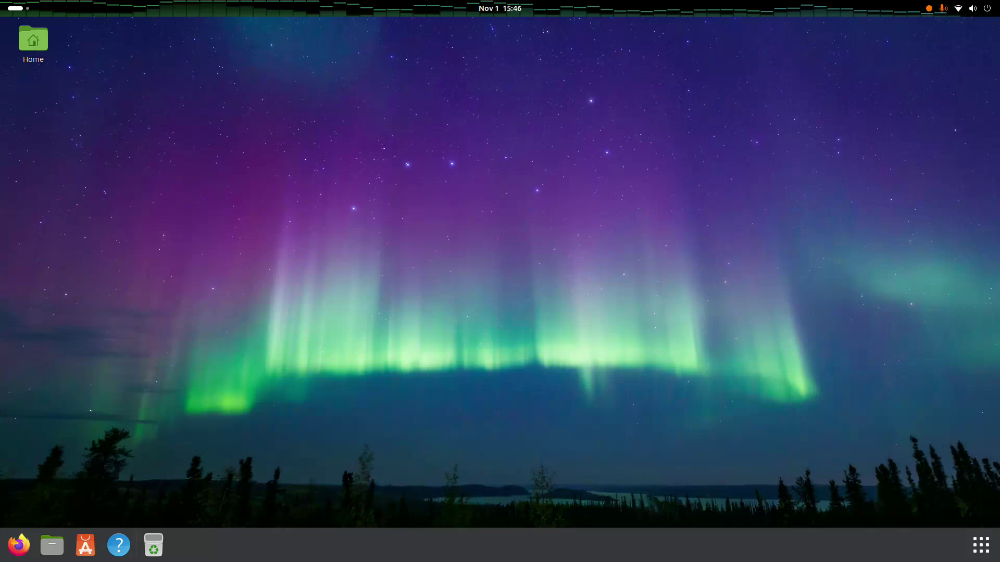

# Audio Visualizer

A GNOME Shell extension that draws a live audio visualizer across the entire
top panel, behind the clock and status icons.

The bars are a faithful port of the player-bar spectrum from
[Spotifast](https://github.com/crmne/spotifast): 75 semitone-spaced bands driven
by Winamp's 512-sample Hann-window FFT, with translucent columns, soft glow,
lingering peak caps, and a bass pulse. A waveform mode uses the same capture.



## Features

- Two modes: **Bars** and **Waveform**, plus **Off**
- Edge-to-edge top-panel overlay, behind all panel indicators
- Peak caps that hang briefly and then fall under gravity
- Colours follow the GNOME accent colour (and change when the accent changes)
- Quick Settings menu with Off / Bars / Waveform and **Restart audio capture**
- Style is remembered in `~/.config/gnome-audio-visualizer.json`
- Capture only: the extension never plays or routes audio
- No background services besides the extension itself

## Requirements

- GNOME Shell 50
- PipeWire (or PulseAudio) with a monitor source for the default output
- GStreamer 1.0 with the `pulsesrc` / `pipewiresrc` plugins

The monitor source is selected with `device=@DEFAULT_MONITOR@`, so it follows
the current default output. If you change the default output while the
visualizer is running, use **Restart audio capture** from the Quick Settings
menu (or switch the style off and on).

## Install from GitHub

Download the latest `audioviz@deanp.shell-extension.zip` from the
[releases page](https://github.com/rgbeans/gnome-audio-visualizer/releases),
then run:

```sh
gnome-extensions install --force audioviz@deanp.shell-extension.zip
```

Log out and back in so GNOME Shell loads the new code, then enable it:

```sh
gnome-extensions enable audioviz@deanp
```

## Install from source

```sh
git clone https://github.com/rgbeans/gnome-audio-visualizer.git
cd gnome-audio-visualizer
gnome-extensions pack --force .
gnome-extensions install --force audioviz@deanp.shell-extension.zip
```

Log out and back in, then enable it.

## Usage

1. Open the Quick Settings menu (top-right corner).
2. Open the **Visualizer** item.
3. Select **Off**, **Bars**, or **Waveform**.
4. If audio stops being captured, select **Restart audio capture**.

The toggle in the Quick Settings grid turns the current style on or off.
Clicking the row while it is off restores the last non-off style.

## How it works

The extension builds a GStreamer pipeline from the default output's monitor:

```text
pulsesrc device=@DEFAULT_MONITOR@
  ! audioconvert ! audioresample
  ! audio/x-raw,format=F32LE,channels=1,rate=44100
  ! appsink
```

Every 16 ms it takes the latest 512 samples, applies a Hann window, and runs a
512-point FFT. The magnitudes are mapped to 75 bands spaced a semitone apart
using Winamp's published `bands()` mapping. Bar heights rise immediately and
fall at 3.0 heights per second; peaks hold for 0.35 s and then accelerate
downward at 2.4 heights/s². Drawing is done with Cairo in an `St.DrawingArea`
inserted at the bottom of the panel's actor stack.

PipeWire/PulseAudio monitor sources are pre-volume, so the visualizer keeps the
same dynamics regardless of the output volume. This also matches Spotifast,
which taps its audio before the volume stage.

## Credits

The analyser and visual style are derived from
[Spotifast](https://github.com/crmne/spotifast) by
[Carmine Paolino](https://github.com/crmne), specifically `WideAnalyser` and
`spectrum()` from `src/vis.rs` and `src/ui/player_bar.rs`. Spotifast is MIT
licensed. Winamp's original FFT and band mapping are the ultimate source of the
algorithm.

## License

MIT. See [LICENSE](LICENSE).
